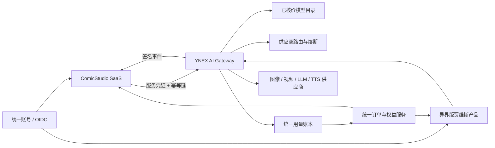

# ComicStudio 与异界版贾维斯商业融合方案

## 结论

采用“一个商业控制面、两个独立产品面”的方式，不合并代码库、不共享业务数据库：

- **异界版贾维斯**：AI 能力网关与商业控制面，负责模型目录、供应商路由、成本核验、用量账本和运营后台。
- **ComicStudio**：漫剧垂直 SaaS，负责用户创作项目、素材、工作流、成片和领域体验。
- **统一平台服务**：独立的身份、套餐权益、订单和结算服务。两个产品只通过版本化 API 与事件通信。

当前商业决策：亿界贾维斯主站是唯一积分、套餐、订单和收款账本。
ComicStudio 不部署独立 Stripe，不维护可充值的本地余额。

### 当前接入边界

贾维斯主站现有 `/api/user/data`、`/api/membership/status`、
`/api/user/credits`、`/api/payments/products` 和 OpenAI 兼容 `/v1/*`
接口，但尚未提供完整的服务间委托协议。正式统一账户前，主站需要补充：

- OIDC/OAuth2 授权码登录或一次性 token exchange，返回稳定且不可变的用户 subject；
- 服务间权益查询，按 `subject` 返回会员、积分和到期时间；
- 带 `Idempotency-Key` 的用量预授权、结算、失败释放接口；
- 已签名的套餐和余额变更事件。

不得用相同邮箱、相同用户名或 ComicStudio 本地用户 ID 猜测主站账户。
在上述接口完成前，ComicStudio 不显示本地余额；尚未接入主站计量的图像、
视频、TTS 和训练能力保持关闭，避免免费使用或双重扣费。

贾维斯现有 `/v1/models` 和 `/v1/chat/completions` 可作为文本能力的第一阶段接入点，但视频、图像、训练等长任务应使用专门的异步任务协议，不能伪装成同步聊天接口。

## 禁止的融合方式

- 不允许两个应用直连或写入对方数据库。
- 不允许复制供应商密钥到 ComicStudio 前端、桌面端或业务数据库。
- 不允许两个产品互相接受对方签发的普通用户 JWT。
- 不允许依据未核验价格目录开放模型，也不允许跨供应商自动替换用户明确选择的模型。
- 不允许在同一公网进程中混合桌面设备控制能力和 ComicStudio 用户素材处理能力。

## 目标架构

## 服务边界

| 能力 | 唯一责任方 | 其他系统如何使用 |
|---|---|---|
| 用户身份、组织、会话 | 统一身份服务 | OIDC Authorization Code + PKCE |
| 套餐、订单、法定例外退款、权益 | 统一商业服务 | 权益查询和签名事件 |
| 模型目录、供应商密钥、路由 | YNEX AI Gateway | 服务到服务 API |
| 成本、预授权、实际用量 | YNEX 用量账本 | request_id 对账 |
| 漫剧项目、角色、分镜、素材 | ComicStudio | 不向贾维斯暴露数据库 |
| 桌面自动化和本机权限 | 贾维斯桌面端 | 与 SaaS 运行面隔离 |

## 内部 API 契约（v1）

所有写请求必须携带 `Authorization: Bearer <service-token>`、`Idempotency-Key`、`X-Request-Id`；令牌使用独立 audience、短有效期，并在网关处校验调用方和租户。

- `GET /internal/v1/models?capability=image|video|llm|tts`
  - 仅返回已通过价格、可调用性和合规审核的模型。
- `POST /internal/v1/generations`
  - 提交长任务；请求包含 `tenant_id`、`end_user_id`、模型、输入引用、预算上限和回调地址。
  - 返回稳定的 `generation_id` 和 `accepted` 状态。
- `GET /internal/v1/generations/{generation_id}`
  - 查询状态、可重试错误和输出资产引用。
- `POST /internal/v1/generations/{generation_id}/cancel`
  - 幂等取消。
- `POST /internal/v1/usage/reservations`
  - 任务执行前预授权最大费用。
- `POST /internal/v1/usage/settlements`
  - 按供应商实际用量结算；同一 `generation_id` 只允许结算一次。

回调采用时间戳 + 请求体摘要签名，接收方保存唯一 `event_id` 防重放。资产通过短时签名 URL 或对象存储复制交付，不传本地文件路径。

## 计费原则

1. 商品价格只由统一商业服务定义，ComicStudio 不保存另一套可变价格表。
2. 网关在调用前做成本预授权，完成后按真实用量结算，失败或空结果自动释放预授权。
3. 供应商成本不可计算、价格证据过期或模型不可调用时，必须阻断任务。
4. ComicStudio 积分是面向用户的权益单位；YNEX 账本记录真实成本和内部结算，两者通过不可变 usage record 对账。

## 分阶段落地

### 阶段 0：各自上线

- ComicStudio 完成支付回调幂等、生产配置校验、安全扫描硬门禁和灾备演练。
- 贾维斯完成密钥轮换、正式代码签名、远端安装包哈希与下载闭环。

### 阶段 1：能力网关

- ComicStudio 只把 LLM 调用接到贾维斯现有 OpenAI 兼容层。
- 新建 `/internal/v1/generations` 承载图像、视频和训练长任务。
- 双方保留独立账号与计费，使用内部对账报表验证成本。

### 阶段 2：统一身份和权益

- 引入独立 OIDC 与统一商业服务。
- 迁移用户映射使用不可变 subject ID，不以邮箱作为外键。
- 通过事件同步权益，不共享数据库。

### 阶段 3：统一品牌入口

- 在统一门户中展示“通用 AI 助手”和“漫剧工作室”两个工作台。
- 后台统一观测 SLA、成本、法定例外退款、滥用和供应商健康度。
- 桌面高权限能力仍保持独立安装与权限边界。

## 上线验收门槛

- 支付：真实沙箱全链路、重复回调、乱序回调、法定例外退款和对账均通过。
- 安全：依赖高危漏洞、密钥扫描、SAST 任一失败即阻断发布。
- 数据：迁移升级/回滚演练、加密备份恢复和对象存储清理补偿通过。
- AI：每个可售模型具备有效价格证据、可调用证据、超时/限流/任务失败积分返还策略。
- 发布：镜像和桌面安装包均有签名、SBOM、SHA-256 和可复现版本号。
- 运维：错误率、任务积压、供应商成本异常和支付回调失败均有告警与值班责任人。
